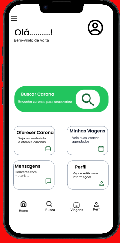

# 🌱 GreenStop

**Aplicativo acadêmico de caronas universitárias**

## 📌 Sobre o projeto

O GreenStop é um projeto acadêmico desenvolvido em grupo com a proposta de facilitar a conexão entre estudantes do UDF interessados em compartilhar caronas.

A ideia é oferecer uma alternativa de mobilidade universitária, incentivando a colaboração entre estudantes.

## 🎯 Objetivo

Facilitar o deslocamento dos estudantes por meio do compartilhamento de caronas, promovendo praticidade, integração e colaboração dentro da comunidade acadêmica.

## 🛠️ Ferramentas utilizadas

- Figma — prototipação das interfaces.
- Miro — planejamento e organização das atividades.

## 👨‍💻 Minha participação

Durante o desenvolvimento do projeto, participei de diferentes etapas:

- Organização do planejamento do projeto no Miro.
- Elaboração e organização da documentação.
- Participação na prototipação das telas.
- Organização dos fluxos e funcionalidades da aplicação.

## 🔗 Materiais do projeto

- [Protótipo no Figma](https://www.figma.com/proto/DvZxPpxxIpms1omIxPFmfR/GreenStop?node-id=0-1)
- [Planejamento no Miro](https://miro.com/app/board/uXjVGg5K8_o=/?share_link_id=740671681970)

## 📚 Contexto acadêmico

Projeto desenvolvido
## 📱 Telas do protótipo

O protótipo do GreenStop apresenta uma proposta de aplicativo para compartilhamento de caronas universitárias.

### Tela inicial

### Menu principal

### Buscar carona

### Detalhes da carona

### Confirmação da solicitação

